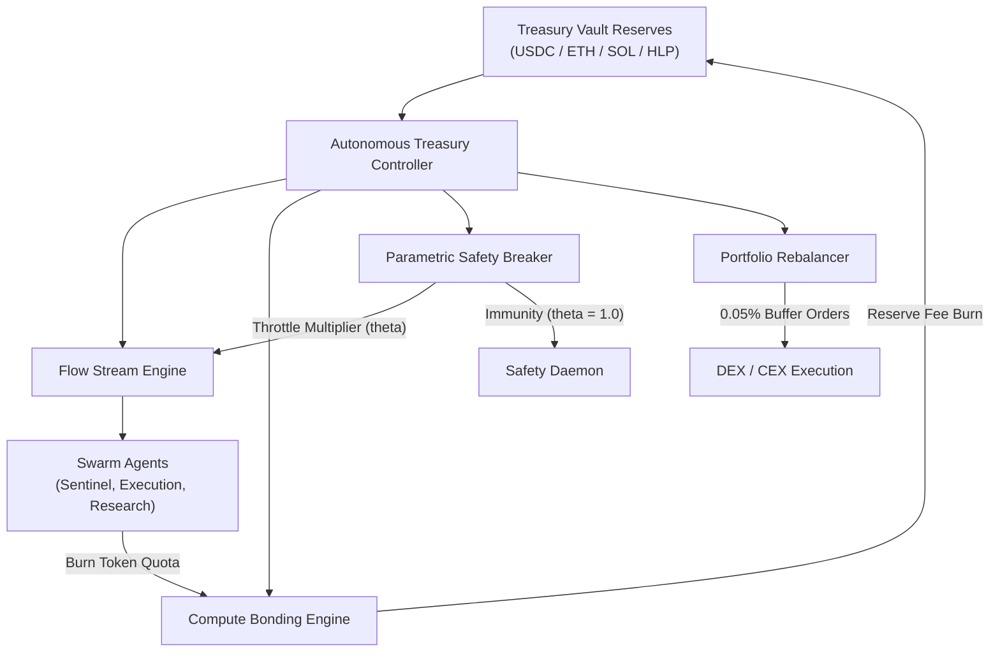

# agent-treasury-stream

> Continuous algorithmic micro-streaming cashflows, compute bonding curves, and drawdown circuit breakers for autonomous AI agent swarms.

[](https://github.com/devsoniclk/agent-treasury-stream/actions)
[](LICENSE)
[](https://www.python.org/downloads/)

---

## Overview

Autonomous AI agent swarms require continuous operational funding to lease compute, pay model inference costs, and reward specialized roles. Traditional lump-sum grants create idle capital risk, counterparty failure, and sudden resource starvation.

`agent-treasury-stream` delivers an institutional treasury engine engineered specifically for multi-agent networks:
1. **Time-Weighted Micro-Streaming:** Sub-second continuous cashflow disbursement across linear, exponential, and cliff vesting curves.
2. **Polynomial Compute Quota Bonding Curves:** Dynamic surge-pricing for compute resources with analytical integral reserves and Newton-Raphson unit solvers.
3. **Parametric Drawdown Circuit Breakers:** Real-time High Water Mark (HWM) tracking with tiered throttling (Caution, Throttle, Defense) and strict immunity for critical safety daemons.
4. **Multi-Asset Rebalancing:** Weight drift monitoring with a mandatory 0.05% orderbook execution buffer and delta-neutral perpetual hedging directives.

---

## Architecture



---

## Key Features

- **Exact Capital Conservation:** Rigorous settlement invariants ensure `Vested + Unvested == TotalAllocation` across all pauses, throttles, and cancellations.
- **Congestion-Aware Bonding:** Dynamic compute unit pricing $P(S) = (P_0 + a \cdot S^k) \cdot \mu_{\text{congestion}}$ with deflationary fee burning.
- **Critical Role Protection:** Core risk monitoring daemons remain 100% funded even during Level 3 portfolio defense freezes.
- **Zero Heavy Dependencies:** Core logic executes with zero required external dependencies; optional CLI powered by Click and Rich.
- **Model Context Protocol (MCP):** Native MCP tools for direct invocation by LLMs and autonomous coding agents.

---

## Installation

```bash
pip install agent-treasury-stream
```

Or install from source:
```bash
git clone https://github.com/devsoniclk/agent-treasury-stream.git
cd agent-treasury-stream
pip install -e .[dev]
```

---

## Quickstart

```python
from agent_treasury_stream import AutonomousTreasuryController, FlowCurveType, SwarmRole

# 1. Initialize Master Controller
controller = AutonomousTreasuryController()

# 2. Open a 30-day linear stream for a Sentinel Agent
stream = controller.open_stream(
    stream_id="stream-sentinel-01",
    beneficiary="agent-sentinel-01",
    role=SwarmRole.SENTINEL,
    total_allocation=10_000.0,
    start_epoch=0.0,
    end_epoch=86400.0 * 30.0,
    curve_type=FlowCurveType.LINEAR,
)

# 3. Query claimable funds after 5 days (432,000 seconds)
claimable = controller.stream_engine.get_claimable_amount("stream-sentinel-01", 432_000.0)
print(f"Claimable: ${claimable:,.2f}")

# 4. Withdraw funds and mint compute quota via bonding curve
withdrawn = controller.stream_engine.execute_withdrawal("stream-sentinel-01", 1000.0, 432_000.0)
units, fee_burned, avg_price = controller.mint_compute_quota("agent-sentinel-01", withdrawn)
print(f"Minted {units:,.2f} compute units (Avg price: ${avg_price:.4f})")
```

---

## CLI Usage

```bash
# Run a 30-day multi-agent swarm simulation
agent-treasury-stream simulate --days 30

# Inspect compute unit spot pricing
agent-treasury-stream curve-price --supply 500.0 --congestion 1.5

# Audit reserve portfolio drift
agent-treasury-stream portfolio-drift
```

---

## Test Suite

Run the full automated test suite with coverage:

```bash
pytest -v --cov=agent_treasury_stream
```

---

## License

This project is licensed under the MIT License - see the [LICENSE](LICENSE) file for details.
